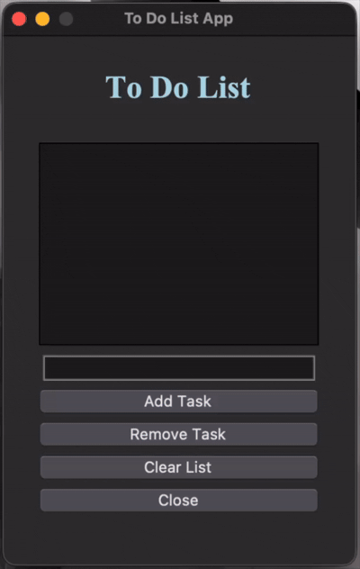
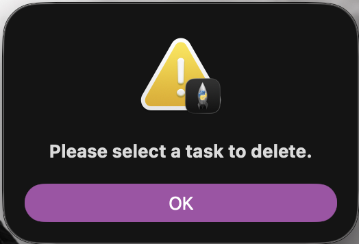

# Project Title
A simple to-do list app using tkinter. 

## Table of Contents
  - [Overview](#overview)
  - [Views](#views)
  - [About](#about)
  - [Process Breakdown](#process-breakdown)
  - [How to Run](#how-to-run)
  - [Tutorial Source](#tutorial-source)
    - [Links](#links)
  - [Author]


## Overview

A visual to-do list created with `tkinter` instead of running the code in the terminal. The goal of this to-do list is to open an empty window where the user can add, edit or remove the tasks from the list. There is a button for each action to be executed, and the user can select the task they would like to delete. There is also a `close` button that will close the application.

```
NOTE: No task will be saved once the application is closed.
```


## Views
<div align="center">
  
</div>


## Process Breakdown

For this application I decided to use the `tkinter` library, which allowed me to explore the simple visual application and understand the functions and attributes that this library offer.

After going through a variety of video tutorials and articles on a simple to do list, I decided to compact all the common knowledge from them and build one from what I have learned from them. The main videos and articles used as reference to create this *to do list application* are available in the [Links](#links) section.

Starting by importing the `tkinter` library and two submodels to be used in the application, one for warning boxes and another for a themed version of the library. Following the `Tk()` class assigned to the root variable, that will be responsible for generating the GUI window for the application. Still using the *root* variable, the title of the window is set, the `resizable()` variable is set to false so the user will not be able to manually resize the window, then the `geometry()` set the fixed size of the window.

The next section of the code is where the functions are. Each funcion was created to be an action of each button in the GUI. The buttons are: *'add task', 'remove task', 'clear list',* and *''close*. The first funcion, `add task`, get the value from the `Entry class` and assign it to a local variable to be checked in a **if statement**, that will check if the variable is empty, and if it is **not** empty, it will get the value from the variable and `insert()` at the end of the list inside the `Listbox class`, and remove the content from the Entry class, so the user doesn't get confused. And if the variable is empty, a message box will pop-up alerting the user that a task need to be typed for the action to be completed.

```
def add_task():
    task = entry_task.get()
    if task != '':
        listbox_task.insert(tk.END, task)
        entry_task.delete(0, tk.END)
    else:
        tk.messagebox.showwarning(title='Warning!', message='You need to enter a task.')
```

The `remove task` function uses the **try except** statement because it doesn't have to check a variable, but rather if there is a selection to run a n action on it. The `curselection()` is used to assigned what the user selected from the Listbox to a variable, and then the `delete` method is called to remove the selection from the Listbox. The exception in this function is called when no item is selected, in this case a warning window will pop-up alerting the user an item needs to be selected for the action to take place.

```
try:
        select_task = listbox_task.curselection()[0]
        listbox_task.delete(select_task)
    except:
        tk.messagebox.showwarning(title='Warning!', message='Please select a task to delete.')
```

<div align="center">
  
</div>

The `clear list` function follow the same logic of the `add task` function, using the **if statement** to check if the *listbox* size and clean if it's not empty. And in case the *listbox* is empty an information message box pops-up to let the user know that there isn't any item in the to do list. And the `close app` function uses the *destroy()* method to close the application window.

After the functions, the `Frame()` class is called in a variable which will be used to organize the boxes inside the GUI root window.

Starting with the `tk.Label()` to add the title of the window, setting up color, font, then using the pack() attributes for the padding and making sure that the item fill the X (horizontal) axis. Followed by the *listbox* and then the *entry* classes, both filling the X (horizontal) axis, and the `tk.Entry()` having the relief parameter to make it visually highlighted for the user. Still on the `tk.Entry()`, a bind menthod was also added to it, using the **lambda event:** so when the used wants to add a task to the To Do List by pressing the 'Return' button, the action `add task` is called.

The four buttons: *'add task', 'remove task', 'clear list',* and *''close*, are below respectively. All the button have the same width and `pack()` connfiguration, and they are also filling the X (horizontal) axis. And at the end, the `mainloop()` method is called, to run the code and start the GUI application.


## How to Run

Download the file `8-todolist.py`.

Open your terminal and find the where the `8-todolist` folder was downloaded, then follow the steps below.

```
# (Optional)Create a Virtual Environment
python3 -m venv venv
```
```
# (Optional)Active Virtual Environment
source .venv/bin/activate
```
```
# Run the Code
python3 8-todolist.py
```

**NOTE:** The code will NOT run on the terminal, a window with the GUI application will open instead.


## Tutorial Source

The source used for the project. A video, PDF file, website page.

[](https://www.youtube.com/embed/8qUJ9a_3zSQ?si=yFa7FTjg49bWrrO0)

### Links
These are the links that were used as reference and guide to adapt the original code to its current source.

- [Python Tkinter Tutorial (Part 1)](https://www.youtube.com/watch?v=epDKamC-V-8&t=1164s) - Using Tkinter Tutorial to code the visual side of the list.
- [Python Tkinter Tutorial (Part 2)](https://www.youtube.com/watch?v=X5yyKZpZ4vU) - Usingt Tkinter classes for the to-do list GUI application.
- [Using Tkinter with Classes](https://www.youtube.com/watch?v=eaxPK9VIkFM) - Understading classes when using tkinter
- [Tkinter Documentation](https://docs.python.org/3/library/tkinter.html) - Tkinter documentation
- [Using the Pack Geometry Manager in Tkinter](https://www.pythonguis.com/tutorials/create-ui-with-tkinter-pack-layout-manager/) - Understanding pack and geometry in Tkinter


## Author

- Developed by Nathalia Santos 🐉<br><br>
[](https://www.linkedin.com/in/naathcs/)