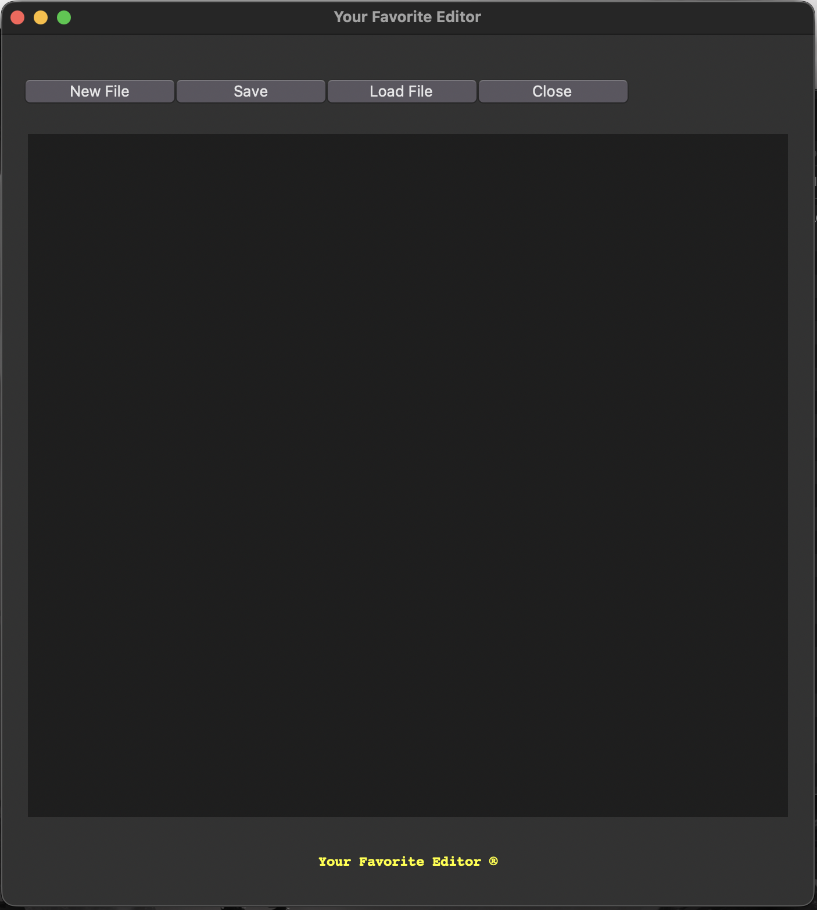
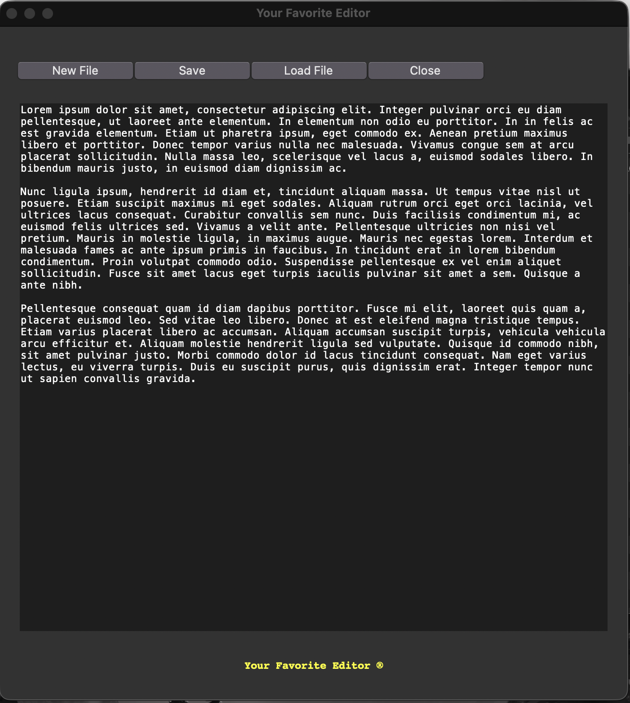

# Project Title
A simple text editor created with tkinter.

## Table of Contents
  - [Overview](#overview)
  - [Views](#views)
  - [Process Breakdown](#process-breakdown)
  - [How to Run](#how-to-run)
  - [Tutorial Source](#tutorial-source)
    - [Links](#links)
  - [Author](#author)

## Overview

A simple text editor that allows the user to create, save, and load a text file. 
It is possible to type in the text box and the text will wrap at the end of the visual limit of the text box. 

## Views

<div align="center">
  
</div>
<br/>
<div align="center">
  
</div>


## Process Breakdown

Starting this editor with the `tkinter` library imports that are used in the code, including the `messagebox` and `filedialog`, that are going to be used along with other `tkinter` functions and locally created ones.

The root variable creates the window where the editor will be placed, using the `geometry()` variable for a fixed size and preventing the user from resizing it. 

The next section of the code contains the functions that are used to run an specific commando for each created button. The first function is the `new_file()`. This method *retrieves the content from the text box widget*, if it is empty, visually nothing happens, if there is any content in it, a pop-up window will appear asking if the user have that content saved. If the answer is negative, the programs asks if they would like to save it. Either if the user saves the file or no, the screen will be cleaned for a new file to be created.

```
# Get content from text box widget from beginning to end, except the last trailing line
content = textBox.get("1.0", "end-1c") 
```

The next function is the `save_file()`. This one uses the `asksaveasfile()` function from the imported library `filedialog`. As the name implies, the function will save the user's file in their desired directory. Starting by assigning the `asksaveasfile()` function to a variable **file**  where this function will have the paramenters that will be the default state of the file to be saved.

```
file = asksaveasfile(
        mode='w',
        defaultextension='.txt',
        title='Untitle File'
    )
```

This function will open what the user usually knows as the '*save as*' window, where they will choose the directory where the file will be saved. The default extension of the file is set to **.txt**. If the user cancel this action, it will return to the text editor screen. If the user saves the file, the function will use the same method to *retrieve the content from the text box widget* and assign the content into a variable, then the `write` method will insert the content into the *file variable* that is being saved. Once that is complete, a pop-up window shows up letting the user know that the file have been saber.

The next is the `load_file` function that start by wrapin the code in a *try/except* statement that will signal the user in case the there was an error opening a file or of no file was selected to be opened in the text editor. Inside, the `askopenfile()` function will have some parameters that will allow the editor to open certains files extensions using the '*filetypes*' and also setting the parameter mode to '*read*', then assigning this function to the file variable.

````
file = askopenfile(
            mode='r',
            title='Select a file...',
            filetypes=[
            ("Text Files", "*.txt"),
            ("Python Files", "*.py"),
            ("All Files", "*.*"),
            ("Document Files", "*.doc")]
        )
````

After that, the file variable is used in a **if statement** where, if it is True, it will read the file and add its content to the text box for the user to view and edit it. If no file is selected or the operation is cancelled, a pop-up windows will appear letting the user know that 'no file was selected'. In case an error occur when trying to open a file, a pop-up windows appear communicating the error.

The last function is the `close_file()` that will close not only the file, but the entire program. This function starts by *retrieving the content from the text box widget*. and checking if there is anything in it. If there anything, a pop-up window appears asking the user if they have saved the file and if they would like to save the file. If the answer is 'yes' and 'no' respectively, the program will close it and the text that was once in there will disappear if not saved.

For the visual section of the editor window, three frame windows are created, one that will hold all the content of the window having a padding from the root window and not allowing everything to be glued to the corners. There is the frame button that will contain all the created  buttons and the editor frame that will contain only the text box. And at the bottom of the window, the name of the editor will be placed in yellow using the **tk.Label()**.

The four buttons are displayed horizontally as `New File`, `Save As`, `Load File`, and `Close`, respectively. All the buttons are set with the same parameters inside the `pack()` variable, this way none of them will look out of place or bigger than the other. And below the buttons, is the text box that uses the **tk.Text()** with a fixed width and height, and also wrapping the text by the word, using the **tk.WORD** value in the wrap parameter. 


## How to Run

Download the file `9-text-editor.py`.

Open your terminal and find the where the `9-text-editor.py` folder was downloaded, then follow the steps below.

```
# (Optional)Create a Virtual Environment
python3 -m venv venv
```
```
# (Optional)Active Virtual Environment
source .venv/bin/activate
```
```
# Run the Code
python3 9-text-editor.py
```

**NOTE:** The code will NOT run on the terminal, a window with the GUI application will open instead.


## Tutorial Source

The source used for the project. A video, PDF file, website page.

[](source link)

### Links
These are the links that were used as reference and guide to adapt the original code to its current source.

- [Tkiter Documentation](https://docs.python.org/3/library/tkinter.html) - Documentation used for the development of 
- [Tkinter Frames](https://docs.python.org/3/library/tkinter.html#tkinter.Frame) - Documentation for Tkinter Frames
- [Python Tkinter - Text Widget](https://www.geeksforgeeks.org/python/python-tkinter-text-widget/) - Understanding the `tk.Text` Widget.
- [Lore Ipsum Generator](https://www.lipsum.com/feed/html) - used to generate a Lore Ipsum text for the text editor.
- [Tkinter File dialog](https://docs.python.org/pt-br/3/library/dialog.html#module-tkinter.filedialog) - DOcumentation for the tkinter file dialog functions.
- [asksaveasfile() function](https://www.tutorialspoint.com/article/asksaveasfile-function-in-python-tkinter) - Understanding how the `asksaveasfile()` function works.
- [askopenfile() function](https://www.tutorialspoint.com/article/askopenfile-function-in-python-tkinter) - Understanding how the `askopenfile()` function works.

## Author

- Developed by Nathalia Santos 🐉<br><br>
[](https://www.linkedin.com/in/naathcs/)